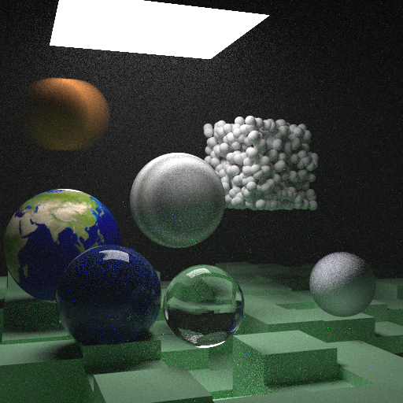
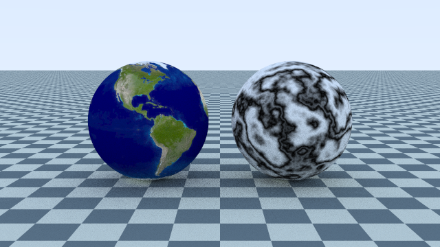
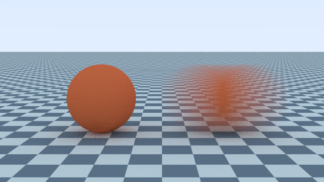
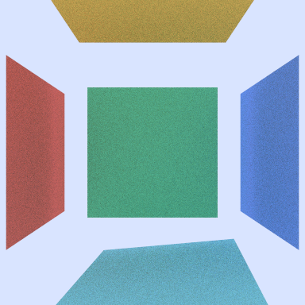
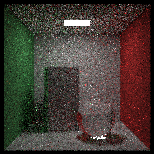

# SoftRayTracer

用 C++17 在 CPU 上做蒙特卡洛路径追踪。下图是第二册的综合场景：画面中的蓝色球体包含参与散射的介质，右上角的白色球簇由 1,000 个球体组成。渲染器通过 BVH 查找交点，并对顶灯采样来估计入射光。



## 与三册教程的对照

对照版本为 **v4.0.2**，原仓库基线为 [`c84349d`](https://github.com/Kenshin627/SoftRayTracer/tree/c84349d)。下表按最终渲染器使用的功能整理。书中用于推导公式的独立数学练习不计入场景列表。[系列主页](https://raytracing.github.io/)

| 教程 | 基线已有 | 本次补齐或修正 | 验证场景 |
| --- | --- | --- | --- |
| [第一册 · In One Weekend](https://raytracing.github.io/books/RayTracingInOneWeekend.html) | 球体求交、递归反弹、漫反射、模糊金属、玻璃折射与全反射、Schlick 近似、抖动抗锯齿、Gamma 2、可调相机和景深 | 修正光圈采样，让样本均匀覆盖圆盘；修正随机球放置时的距离判断，启用渐变天空，支持 PPM 输出 | `random` |
| [第二册 · The Next Week](https://raytracing.github.io/books/RayTracingTheNextWeek.html) | AABB/BVH、轴对齐矩形、长方体、平移与 Y 轴旋转、面光源、恒定密度介质 | 加入运动球与快门时间、球面和四边形 UV、棋盘格、图像纹理、Perlin 湍流大理石、任意朝向平行四边形、纹理发光与纹理介质。修正长方体深度、实例内外表面判定及 BVH 叶节点重复采样介质的问题 | `textures`、`motion`、`quads`、`smoke`、`final` |
| [第三册 · The Rest of Your Life](https://raytracing.github.io/books/RayTracingTheRestOfYourLife.html) | 按材质生成散射方向 | 加入像素分层采样、局部正交基、余弦半球与均匀球面 PDF、四边形面积到立体角的换算、球体可见锥采样，以及材质和多个几何目标的混合 PDF。发光面支持单面出光，玻璃与金属走各自的反射／折射路径 | `cornell`，可切换两种采样模式 |

## 构建并渲染第一张图

**Windows / Visual Studio 2022**。在仓库根目录运行以下 PowerShell 命令。GLM、stb 和 Windows 版 SDL2 已随仓库提供。

```powershell
cmake -S . -B build -G "Visual Studio 17 2022" -A x64
cmake --build build --config Release --parallel
$rt = ".\build\Release\SoftRayTracer.exe"
& $rt --scene textures --width 640 --height 360 --spp 64 --depth 24 --seed 7 --output textures.png
```

也可以直接打开 `SoftRayTracer.sln`，选择 `Release | x64` 后启动。默认打开 SDL 窗口显示烟雾盒。添加 `--output` 可直接写入 PNG 或二进制 PPM。两种输出共用相机、积分器和像素缓冲。

**无窗口构建**。使用 CMake 3.16+、C++17 编译器和单配置生成器。检测到 OpenMP 时会按扫描线并行渲染。

```sh
cmake -S . -B build-headless -DSOFTRAY_SDL=OFF -DCMAKE_BUILD_TYPE=Release
cmake --build build-headless --parallel
./build-headless/SoftRayTracer --scene motion --width 640 --height 360 --spp 100 --depth 24 --seed 7 --output motion.png
```

`--help` 列出场景和参数。默认分辨率为 600 × 600，每像素 50 个样本（spp），最大反弹深度 50，随机种子 1。无窗口版本默认写入 `render.png`。构建时会将地球纹理复制到程序旁的 `assets/`，也可以用 `--earth 文件路径` 替换它。

## 渲染图集

以下 PNG 均由本项目直接输出。图集使用 `--seed 7 --depth 24`，尺寸与采样数标在各图下方。首页综合场景使用 `--scene final --width 512 --height 512 --spp 400`。

| 球面 UV 与程序纹理 | 快门时间与运动模糊 |
| --- | --- |
|  |  |
| `textures` · 640 × 360 · 64 spp。左球使用经纬度 UV 读取图像，右球以三维位置计算 Perlin 湍流，地面使用棋盘格。 | `motion` · 640 × 360 · 100 spp。左球静止，右球在一次曝光中水平移动。每条路径在全部反弹中保留同一快门时刻。 |

| 漫反射、金属、玻璃与景深 | 平行四边形 |
| --- | --- |
|  |  |
| `random` · 640 × 360 · 49 spp。前景与远处的小球随焦距产生不同程度的虚化。 | `quads` · 384 × 384 · 36 spp。底部面板的两条边斜交，求交与 UV 使用同一组局部坐标。 |

| 体积散射 | 玻璃与间接光 |
| --- | --- |
|  |  |
| `smoke` · 384 × 384 · 196 spp。两个旋转的长方体限定黑烟和白雾的边界，散射距离按指数分布采样。 | `cornell` · 512 × 512 · 400 spp。向顶灯和玻璃球采样，可以看到球底的亮斑和墙面的反射色。 |

### 相同采样预算下的 Cornell 盒

两张图共用场景、相机、分辨率、种子和深度，每像素都是 16 个样本。左图仅按材质选取方向，小面积顶灯很难命中。右图在漫反射处以相等概率选择材质分布或几何目标分布，再以混合密度加权。这个场景的几何目标是顶灯和玻璃球，两者被选中的概率相等。

| `--sampling material` | `--sampling mixture`（默认） |
| --- | --- |
|  |  |

```powershell
foreach ($mode in "material", "mixture") {
    & $rt --scene cornell --width 256 --height 256 --spp 16 --depth 24 --seed 7 --sampling $mode --output "cornell-$mode.png"
}
```

以同一场景的 1,024 spp 混合采样图作参考（种子 19），上述两张图的 RGB 均方根误差分别为 **0.269** 和 **0.094**。误差在输出 PNG 的 RGB 通道归一化到 0–1 后计算，包含 Gamma 和亮度截断的影响。

## 代码与验证

场景构建、路径积分、纹理和方向采样分别位于 [Scenes.cpp](SoftRayTracer/src/Scenes.cpp)、[RayTracer.cpp](SoftRayTracer/src/Renderer/RayTracer.cpp)、[Texture.cpp](SoftRayTracer/src/Material/Texture.cpp) 和 [Sampling.h](SoftRayTracer/src/Renderer/Sampling.h)。四边形与运动球实现各自的求交、包围盒和方向密度。[Quad.cpp](SoftRayTracer/src/Model/Quad.cpp) · [Sphere.cpp](SoftRayTracer/src/Model/Sphere.cpp)

```sh
ctest --test-dir build -C Release --output-on-failure
```

测试包含七个场景的命令行渲染，以及运动包围盒、球面与四边形 UV、采样方向与密度、单面出光、实例法线、反弹时间、光圈分布和介质消光的回归检查。使用单配置构建时，将上面的 `build` 换成实际构建目录。[测试源码](tests/render_checks.cpp)

地球表面贴图取自教程 v4.0.2。图像读写使用 stb，Perlin 噪声使用仓库内的 GLM 实现。[原始地球贴图](https://github.com/RayTracing/raytracing.github.io/blob/v4.0.2/images/earthmap.jpg) · [stb](https://github.com/nothings/stb) · [GLM](https://github.com/g-truc/glm)
