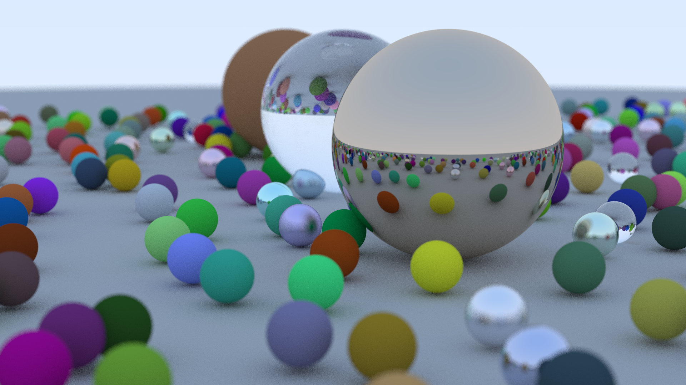
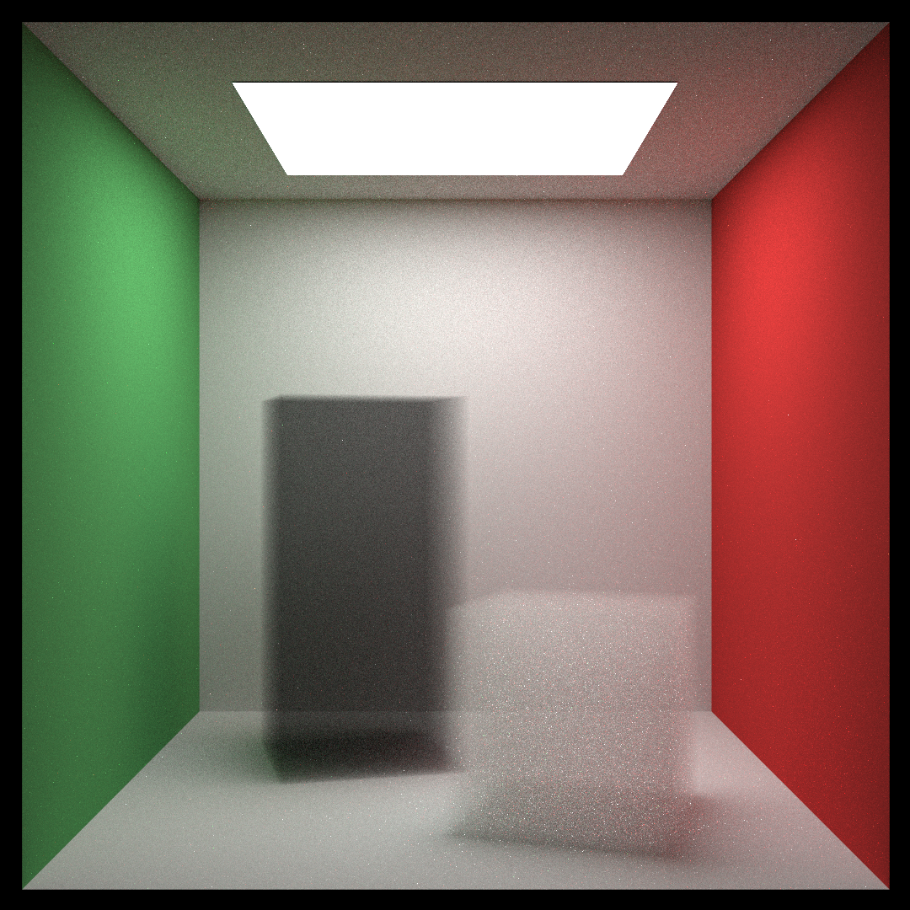
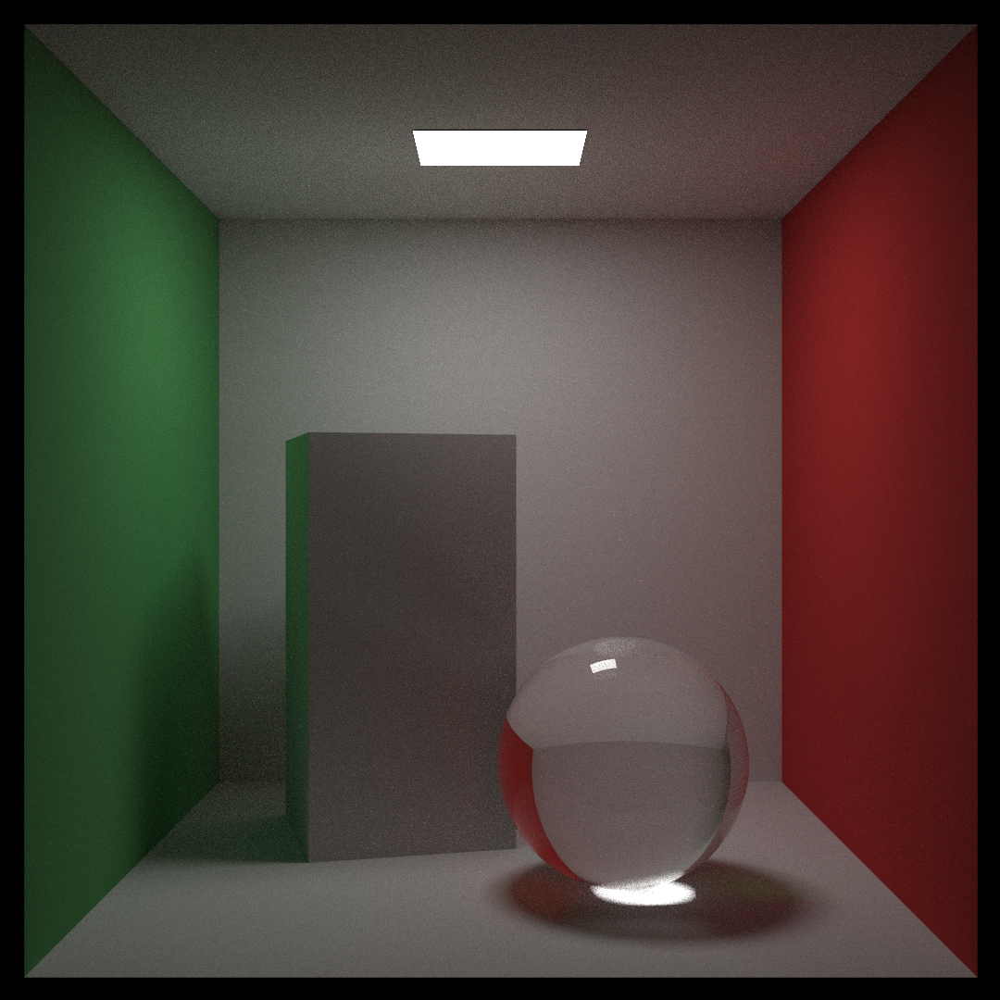
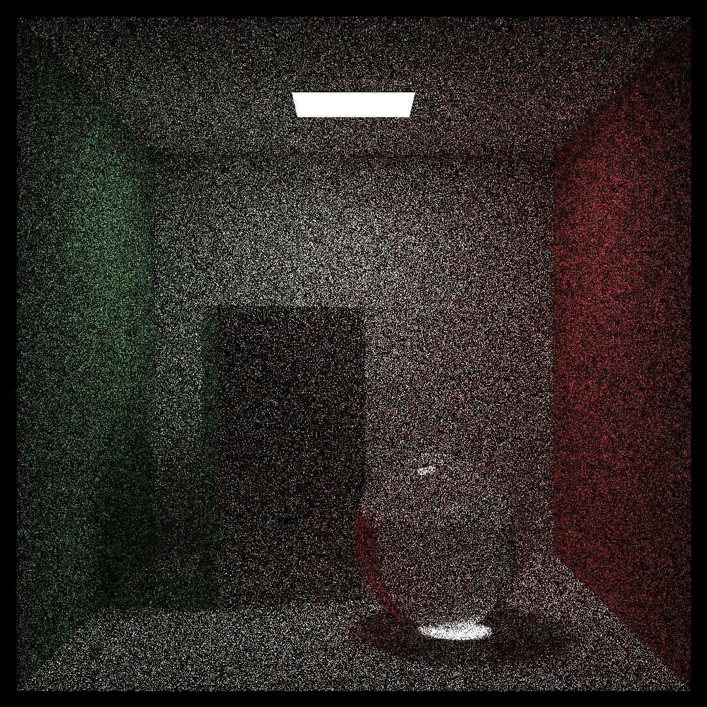

# SoftRayTracer

SoftRayTracer 是用 C++17 实现的 CPU 路径追踪器。下图中，蓝色球体内的介质会散射光线，右上角的球簇由 1,000 个白球组成。渲染器用包围体层次结构（BVH）加速求交，并对顶灯采样来估计入射光。

[](docs/renders/final.png?raw=1)

综合场景 · 1080 × 1080 · 每像素 1,600 次采样。点击图片可打开原尺寸 PNG。

## 渲染特性

| 模块 | 实现 | 示例场景 |
| --- | --- | --- |
| 相机 | 透视投影、可调视场、薄透镜景深和快门时间采样。运动球在每条光路对应的曝光时刻参与求交。 | `random`、`motion` |
| 几何与加速 | 球体、任意朝向的平行四边形、长方体、平移与 Y 轴旋转。BVH 同时支持静态物体和运动球的包围盒。 | `quads`、`final` |
| 表面与纹理 | 漫反射、粗糙金属、玻璃折射与全反射、单面发光。球面和四边形支持 UV 映射，也可按三维位置生成棋盘格和 Perlin 大理石纹理。 | `random`、`textures`、`cornell` |
| 参与介质 | 在物体边界内按指数分布采样自由程，以各向同性散射模拟恒定密度的烟雾。 | `smoke`、`final` |
| 积分与采样 | 像素分层采样、递归路径积分、余弦半球与均匀球面采样。可将材质采样与面光源、球体的方向采样混合，降低间接照明中的噪声。 | `cornell`、`final` |

## 构建并渲染第一张图

**Windows / Visual Studio 2022**。在仓库根目录运行以下 PowerShell 命令。GLM、stb 和 Windows 版 SDL2 已随仓库提供。

```powershell
cmake -S . -B build -G "Visual Studio 17 2022" -A x64
cmake --build build --config Release --parallel
$rt = ".\build\Release\SoftRayTracer.exe"
& $rt --scene textures --width 1920 --height 1080 --spp 100 --depth 24 --seed 7 --output textures.png
```

也可以直接打开 `SoftRayTracer.sln`，选择 `Release | x64` 后启动。默认打开 SDL 窗口显示烟雾盒。添加 `--output` 可直接写入 PNG 或二进制 PPM。两种输出共用相机、积分器和像素缓冲。

**无窗口构建**。使用 CMake 3.16+、C++17 编译器和单配置生成器。检测到 OpenMP 时会按扫描线并行渲染。

```sh
cmake -S . -B build-headless -DSOFTRAY_SDL=OFF -DCMAKE_BUILD_TYPE=Release
cmake --build build-headless --parallel
./build-headless/SoftRayTracer --scene motion --width 1920 --height 1080 --spp 144 --depth 24 --seed 7 --output motion.png
```

`--help` 列出场景和参数。默认分辨率为 600 × 600，每像素 50 个样本（spp），最大反弹深度 50，随机种子 1。无窗口版本默认写入 `render.png`。构建时会将地球纹理复制到程序旁的 `assets/`，也可以用 `--earth 文件路径` 替换它。

## 渲染图集

以下 PNG 均由渲染器按标注尺寸直接输出。所有场景使用 `--seed 7 --depth 24`。可用 `--scene final --width 1080 --height 1080 --spp 1600` 复现页首综合场景。

### 球面 UV 与程序纹理

`textures` · 1920 × 1080 · 100 spp。左球使用经纬度 UV 读取地球贴图，右球以三维位置计算 Perlin 湍流，地面使用棋盘格。

[](docs/renders/textures.png?raw=1)

### 快门时间与运动模糊

`motion` · 1920 × 1080 · 144 spp。左球静止，右球在一次曝光中水平移动。每条光路在全部反弹中保留同一快门时刻。

[](docs/renders/motion.png?raw=1)

### 漫反射、金属、玻璃与景深

`random` · 1920 × 1080 · 100 spp。金属球映出周围的球阵，焦平面前后的小球随距离产生不同程度的虚化。

[](docs/renders/random.png?raw=1)

### 平行四边形

`quads` · 1080 × 1080 · 64 spp。底部青色面板的两条边斜交，求交与 UV 使用同一组局部坐标。

[](docs/renders/quads.png?raw=1)

### 体积散射

`smoke` · 1080 × 1080 · 256 spp。两个旋转的长方体限定黑烟和白雾的边界，散射距离按指数分布采样。

[](docs/renders/smoke.png?raw=1)

### 玻璃与间接光

`cornell` · 1080 × 1080 · 576 spp。顶灯照亮玻璃球和高箱，球底形成亮斑，白墙上可见邻近彩墙的反射色。

[](docs/renders/cornell.png?raw=1)

### 相同采样预算下的 Cornell 盒

以下两张图共用场景、相机和种子，均为 1080 × 1080、16 spp。

**纯材质采样**（`--sampling material`）。仅按材质选取方向时，少数光路命中顶灯，墙面与地板可见稀疏亮点。

[](docs/renders/cornell-material.png?raw=1)

**混合采样**（`--sampling mixture`）。在漫反射处，以相等概率选择材质分布或几何目标分布，再以混合密度加权。几何目标是顶灯和玻璃球，两者被选中的概率相等。

[](docs/renders/cornell-mixture.png?raw=1)

```powershell
foreach ($mode in "material", "mixture") {
    & $rt --scene cornell --width 1080 --height 1080 --spp 16 --depth 24 --seed 7 --sampling $mode --output "cornell-$mode.png"
}
```

在单独的 256 × 256 基准测试中，两种模式都使用 16 spp。以同尺寸、1,024 spp 的混合采样图作参考（种子 19），纯材质采样与混合采样的 RGB 均方根误差分别为 **0.269** 和 **0.094**。误差在输出 PNG 的 RGB 通道归一化到 0–1 后计算。

## 代码与验证

场景构建、路径积分、纹理和方向采样分别位于 [Scenes.cpp](SoftRayTracer/src/Scenes.cpp)、[RayTracer.cpp](SoftRayTracer/src/Renderer/RayTracer.cpp)、[Texture.cpp](SoftRayTracer/src/Material/Texture.cpp) 和 [Sampling.h](SoftRayTracer/src/Renderer/Sampling.h)。四边形与运动球实现各自的求交、包围盒和方向密度。[Quad.cpp](SoftRayTracer/src/Model/Quad.cpp) · [Sphere.cpp](SoftRayTracer/src/Model/Sphere.cpp)

```sh
ctest --test-dir build -C Release --output-on-failure
```

测试包含七个场景的命令行渲染，以及运动包围盒、球面与四边形 UV、采样方向与密度、单面出光、实例法线、反弹时间、光圈分布和介质消光的回归检查。使用单配置构建时，将上面的 `build` 换成实际构建目录。[测试源码](tests/render_checks.cpp)

地球表面使用随项目分发的经纬度贴图。图像读写使用 stb，Perlin 噪声由 GLM 计算。[地球贴图](SoftRayTracer/assets/earthmap.jpg) · [stb](https://github.com/nothings/stb) · [GLM](https://github.com/g-truc/glm)
